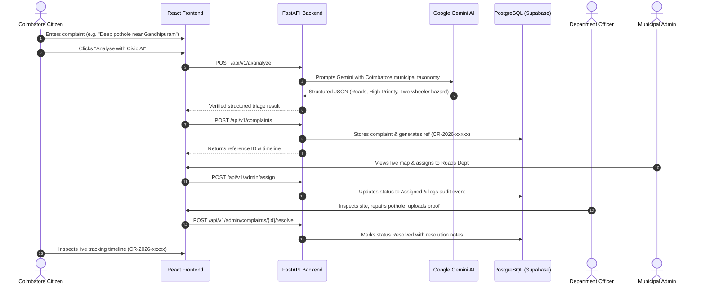

# CivicResolve — AI-Powered Citizen Grievance & Civic Intelligence Platform

> **"Your city. Your voice. Your impact."**  
> Submission for **PromptWars × GDG on-Campus PSG iTech**  
> Focused initially on **Coimbatore, Tamil Nadu, India**

[](https://vitejs.dev)
[](https://fastapi.tiangolo.com)
[](https://ai.google.dev)
[](https://leafletjs.com)
[](https://supabase.com)
[]()

---

## 1. Executive Summary & Problem Statement

Civic grievance redressal in Indian tier-2 cities often suffers from fragmented departmental boundaries, delayed priority identification, lack of transparent tracking, and duplicate complaints.

**CivicResolve** transforms municipal grievance management for the **Coimbatore Municipal Corporation** into an intelligent, transparent, and GIS-driven operating system connecting:
1. **Citizens**: File problems in 30 seconds with photo proof, exact location pins, and real-time lifecycle tracking.
2. **Civic AI Engine (Google Gemini)**: Analyzes unstructured Tamil/English complaints, assesses public safety risk, categorizes into 6 departments, and detects proximate duplicates.
3. **Municipal Administrators**: Real-time control room with Recharts visualizations, departmental workload balancing, and SLA tracking.
4. **Field Officers**: Dispatch execution squads and record verified on-site photo resolutions with complete audit trails.
5. **The Public**: Open civic intelligence portal displaying verified resolution rates across Coimbatore wards without PII leakage.

---

## 2. Key Features

- **Soft Minimal + Editorial GIS Interface**: Built to look and feel like an elite modern civic dashboard (Colors: `#F3F2EE` background, `#203D32` primary brand, `#2F8F68` resolved, Manrope & Inter typography).
- **Interactive Coimbatore GIS Map**: OpenStreetMap Leaflet integration with category color coding (Roads `#D9534F`, Sanitation `#5B9A5B`, Electrical `#E0A526`, Water `#3B82C4`, Drainage `#8A63C9`, Parks `#2F8F83`), marker pulse on critical hazards, and density heatmaps.
- **Genuine Server-Side Gemini AI**: Analyzes grievance text, severity (1-5), safety risks (e.g. "Two-wheeler skid hazard"), and suggests specific technical actions.
- **Proximity Duplicate Detection**: Uses Haversine distance and token similarity within a 300m radius, enabling citizens to endorse existing reports instead of filing clutter duplicates.
- **End-to-End Audited Lifecycle**: `Reported → Under Review → Assigned → In Progress → Resolved`, with timestamped change logs and officer notes.
- **Role-Based Access Control**: Pre-configured evaluator personas (Citizen: Priya Sundaram, Admin: Commissioner Dr. Anand Ramanathan IAS, Officer: Er. Vigneshwaran K.).

---

## 3. Technology Stack

| Layer | Technologies |
|---|---|
| **Frontend** | React 18, TypeScript, Vite, Tailwind CSS, React Router 6, Lucide React, Recharts, Leaflet, React-Leaflet |
| **Backend** | Python 3.14+, FastAPI, Pydantic v2, Uvicorn, HTTPX |
| **AI Integration** | Official Google Gen AI SDK (`google-genai`), Gemini 2.5 Flash / 1.5 Flash |
| **Database & Auth** | Supabase PostgreSQL, Row Level Security (RLS) policies, PostGIS-ready coordinate indexes |
| **Geographical** | OpenStreetMap, Leaflet, Nominatim Geocoding, Haversine geospatial calculations |
| **Deployment Targets** | Vercel (Frontend), Render (FastAPI Backend), Supabase (Database & Storage) |

---

## 4. Architecture



---

## 5. Repository Structure

```
CivicResolve/
├── backend/
│   ├── app/
│   │   ├── main.py                    # FastAPI application & health endpoint
│   │   ├── core/                      # Configuration, settings & security
│   │   ├── schemas/                   # Pydantic v2 validation models
│   │   ├── services/                  # Business logic (complaints, duplicates, GIS, analytics)
│   │   ├── ai/                        # Google Gemini SDK service & prompts
│   │   ├── database/                  # Supabase connection & persistent store
│   │   └── api/routes/                # Endpoints (complaints, ai, maps, admin, analytics)
│   ├── tests/
│   │   └── run_tests.py               # Comprehensive 9-test verification suite
│   └── requirements.txt
├── database/
│   ├── migrations/
│   │   ├── 001_initial_schema.sql     # PostgreSQL normalized tables & indexes
│   │   └── 002_rls_policies.sql       # Row Level Security RBAC policies
│   └── seed/
│       └── seed_data.sql              # Verified Coimbatore zones, wards, departments & seed cases
├── frontend/
│   ├── src/
│   │   ├── app/                       # App root & React Router
│   │   ├── components/                # Reusable header, footer, CoimbatoreMap
│   │   ├── pages/                     # Landing, Map, Report, Track, Dashboard, Admin, Analytics, Auth
│   │   ├── services/                  # Centralized API service & offline fallback
│   │   └── types/                     # TypeScript data interfaces
│   ├── package.json
│   ├── tailwind.config.js             # Design tokens & typography
│   └── vite.config.ts
├── docs/
│   └── architecture.md                # System flowcharts & GIS taxonomy
├── .env.example                       # Environment template
├── .gitignore                         # Excludes node_modules, dist, __pycache__, etc.
└── README.md
```

---

## 6. Local Setup & Execution

### Prerequisites
- Node.js v18+ (tested on Node v24)
- Python 3.10+ (tested on Python 3.14)
- Git

### 1. Clone & Configure
```bash
git clone https://github.com/your-username/CivicResolve.git
cd CivicResolve

# Copy environment template
cp .env.example .env
```

### 2. Run Backend
```bash
# Install dependencies
pip install -r backend/requirements.txt

# Run backend tests
python -u backend/tests/run_tests.py

# Start FastAPI server
uvicorn backend.app.main:app --host 0.0.0.0 --port 8000 --reload
```
API Documentation will be live at: `http://localhost:8000/docs`  
Health check endpoint: `http://localhost:8000/health`

### 3. Run Frontend
```bash
cd frontend
npm install
npm run build    # Verifies production bundle
npm run dev      # Launches dev server at http://localhost:5173
```

---

## 7. Demo Evaluation Personas

For judges and evaluators, the header includes an instant **Role Switcher** that simulates distinct RBAC permissions across Coimbatore:

| Persona | Role | Location | Permissions |
|---|---|---|---|
| **Priya Sundaram** | Citizen | Ward 70 (Gandhipuram) | Report grievances, AI triage preview, endorse reports, track timeline |
| **Dr. Anand Ramanathan, IAS** | Administrator | Municipal Corporation HQ | Zonal control room, assign departments, inspect audit logs, view city metrics |
| **Er. Vigneshwaran K.** | Department Officer | Roads Department | Field queue inspection, update work progress, record verified on-site resolution |

---

## 8. Cloud Deployment Configuration

### Architecture Overview
- **Frontend**: Vercel (SPA routing, global edge CDN)
- **Backend**: Google Cloud Run (Containerized FastAPI, auto-scaling, request-based billing)
- **Database & Auth**: Supabase PostgreSQL with Row Level Security (RLS) & Supabase Storage
- **AI Intelligence**: Google Gemini API via official `google-genai` SDK
- **GIS Services**: Leaflet + OpenStreetMap (Attributed, zero paid Google Maps API dependencies)

---

### Backend Deployment (Google Cloud Run)
1. **Container Image**: Built via `backend/Dockerfile` based on `python:3.11-slim`, running with an unprivileged system user (`appuser`).
2. **Dynamic Port Binding**: Uvicorn dynamically binds to the Cloud Run `${PORT:-8080}` environment variable.
3. **Health Probes**: Startup and liveness probes target `GET /health`.
4. **Cost Guardrails & Scaling Settings**:
   - **Scale to Zero**: `minScale: 0` ensures zero compute cost during idle periods (request-based billing).
   - **Max Instances**: `maxScale: 3` enforces a hard cost ceiling against unexpected traffic spikes.
   - **Resource Limits**: 1 vCPU, 512 MiB RAM, 80 concurrent requests per container.
   - **CORS Restriction**: Strict CORS whitelist matching only the deployed frontend domains.

Deploy with the Google Cloud CLI:
```bash
# Submit build and deploy to Cloud Run in asia-south1 (Mumbai)
gcloud builds submit --tag gcr.io/$PROJECT_ID/civicresolve-backend:latest -f backend/Dockerfile .

gcloud run deploy civicresolve-backend \
  --image gcr.io/$PROJECT_ID/civicresolve-backend:latest \
  --platform managed \
  --region asia-south1 \
  --allow-unauthenticated \
  --port 8080 \
  --min-instances 0 \
  --max-instances 3 \
  --cpu 1 \
  --memory 512Mi \
  --concurrency 80 \
  --timeout 60s \
  --set-env-vars ENVIRONMENT=production,CITY_FOCUS=Coimbatore,GEMINI_MODEL=gemini-2.5-flash \
  --set-env-vars CORS_ORIGINS="https://civicresolver.vercel.app,https://civicresolve.vercel.app"
```

---

### Frontend Deployment (Vercel)
1. **Build Configuration**:
   - Framework Preset: `Vite`
   - Root Directory: `frontend` (or repository root using `vercel.json`)
   - Build Command: `npm run build`
   - Output Directory: `dist`
2. **SPA Routing Rewrites**: Handled automatically via `vercel.json`:
   ```json
   {
     "rewrites": [{ "source": "/(.*)", "destination": "/index.html" }]
   }
   ```
3. **Production Environment Variables**:
   - `VITE_API_BASE_URL`: URL of the deployed Cloud Run service (e.g. `https://civicresolve-backend-xxx.a.run.app`)
   - `VITE_SUPABASE_URL`: Supabase project URL
   - `VITE_SUPABASE_ANON_KEY`: Supabase anon/public key

---

### Database & Storage (Supabase)
Execute SQL migrations in the Supabase SQL Editor:
1. `database/migrations/001_initial_schema.sql` (Creates 14 tables and spatial indexes)
2. `database/migrations/002_rls_policies.sql` (Enforces Row Level Security policies)
3. `database/seed/seed_data.sql` (Populates verified Coimbatore zones, wards, and seed complaints)

---

### Cost & Security Controls
- **Google Cloud Budget Alerts**: Configured in Google Cloud Console (`Billing > Budgets & alerts`) with 50%, 80%, and 100% threshold alerts.
- **Gemini API Quota Limits**: Monitored via Google AI Studio / Google Cloud Console to prevent quota exhaustion.
- **Zero Committed Secrets**: `.env` is strictly gitignored; all secrets are supplied via Cloud Run and Vercel dashboards.

---

## 9. Git Repository Compliance Check

Strict compliance with competition submission criteria:
- **Git Branch**: Exactly one branch: `main`. No extraneous branches created.
- **Repository Size**: Strictly under 10 MB (Cleaned of all binary artifacts, dependencies, and build outputs).
- **Sensitive Secrets**: Zero private keys committed (`.env` strictly gitignored; `.env.example` provided).

```bash
# Verify repository size and single branch
git branch --show-current   # Outputs: main
git count-objects -vH       # Confirms size < 10 MB
```

---

## 10. License

Developed for **PromptWars × GDG on-Campus PSG iTech**. Distributed under the MIT License.
