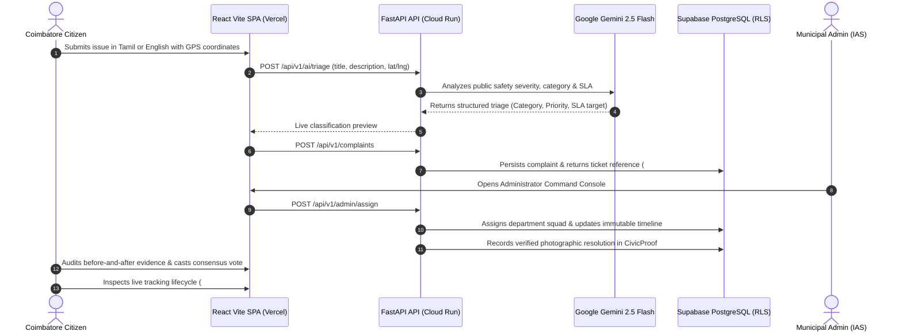

# CivicResolver — Municipal Grievance & Civic Intelligence Platform

> **"Your City. Your Voice. Your Impact."**  
> Developed for **PromptWars × GDG on-Campus PSG iTech**  
> Initial Deployment Region: **Coimbatore Municipal Corporation, Tamil Nadu, India**

[](https://vitejs.dev)
[](https://fastapi.tiangolo.com)
[](https://ai.google.dev)
[](https://supabase.com)
[](https://leafletjs.com)
[-brightgreen.svg)]()
[-167A4D.svg)]()

---

## 1. Executive Summary

Municipal grievance redressal across Indian tier-2 urban corridors frequently faces departmental fragmentation, manual triage delays, invisible repair verifications, and duplicate grievance backlogs.

**CivicResolver** transforms municipal operations for the **Coimbatore Municipal Corporation** into an intelligent, transparent, and GIS-driven operating system:
- **Instant AI Triage**: Evaluates unstructured grievance descriptions in Tamil, English, and Hindi, automatically scoring public safety risk (1–100), detecting SLAs, and routing to the correct department.
- **CivicProof Community Audit**: Closed-loop field inspection evidence featuring photographic before-and-after proof, consensus citizen voting, and administrative dispute reopening.
- **CivicPulse Predictive Radar**: Geospatial clustering that identifies chronic infrastructure failure patterns before seasonal monsoons cause widespread disruption.
- **Executive Administrator Command & Control**: Zonal telemetry, real-time workload balancing, and sanitized non-PII CSV audit export.
- **Multilingual By Design**: Instant zero-reload switching across **English**, **தமிழ் (Tamil)**, and **हिंदी (Hindi)**.

---

## 2. Platform Architecture



---

## 3. Key Feature Modules

### A. Citizen Grievance Portal
- **30-Second Submission**: Geocoded landmark input, device GPS pin, and automatic image compression ($\le$ 300KB).
- **Instant AI Severity Scoring**: Automated department classification (Roads, Sanitation, Electrical, Water, Drainage, Parks) with actionable safety risk explanations.
- **Proximity Duplicate Detection**: Haversine distance and token-similarity clustering within 300m to prevent duplicate clutter.
- **Interactive Lifecycle Tracking**: Real-time audit timeline (`Reported → Under Review → Assigned → In Progress → Resolved`).

### B. CivicProof™ Community Verification Stream
- **Photographic Inspection Evidence**: High-resolution, self-contained before-and-after evidence comparing reported hazards to field rectifications.
- **Consensus Community Auditing**: Citizens verify field quality by voting (*Resolved*, *Partially Resolved*, or *Still Exists*).
- **Administrative Dispute Resolution**: When complaints are disputed by citizens, administrators can reopen tickets for official squad re-inspection.

### C. CivicPulse™ Predictive Infrastructure Radar
- **Cluster Diagnostics**: Analyzes chronic failure corridors across Coimbatore (Periyakulam Bund, Gandhipuram, RS Puram, Peelamedu).
- **Preventative Forecasting**: Early warning alerts targeting pre-monsoon culvert desilting, arterial road re-carpeting, and high-tension transformer inspections.

### D. Municipal Administrator Command & Control
- **Executive Telemetry**: Citywide resolution rates, active SLA compliance metrics, and zonal grievance breakdowns.
- **Triage & Department Reassignment**: Real-time reallocation across municipal departments with official instructions.
- **Sanitized Audit Export**: One-click non-PII CSV export compliant with public transparency guidelines.

### E. Global Civic AI Assistant
- Contextual municipal assistant floating widget with pre-loaded guidance for both **Citizen** and **Administrator** modes.

---

## 4. Technology Stack

| Layer | Technology | Purpose |
| :--- | :--- | :--- |
| **Frontend Framework** | **React 18 + TypeScript + Vite** | High-performance, zero-latency responsive single-page application |
| **Design System** | **Tailwind CSS + Lucide React** | Enterprise GovTech aesthetic (`#167A4D`, `#12382C`, `#F8FAFC`) |
| **Data Visualizations** | **Recharts** | Real-time zonal bar charts and telemetry gauges |
| **GIS Mapping** | **Leaflet + OpenStreetMap** | Ward boundary GIS and color-coded priority markers |
| **Backend Framework** | **Python 3.11 + FastAPI + Uvicorn** | High-throughput asynchronous REST API with Pydantic v2 validation |
| **AI Intelligence** | **Google Gemini 2.5 Flash** | Multimodal image verification, sentiment extraction, and automated triage |
| **Database & Auth** | **Supabase PostgreSQL** | Row Level Security (RLS), PostGIS coordinates, and citizen authentication |
| **Vector Evidence** | **Base64 SVG Engine** | Self-contained, zero-dependency field proof images |

---

## 5. Repository Structure

```
CivicResolver/
├── backend/
│   ├── app/
│   │   ├── main.py                    # FastAPI root application & GET /health
│   │   ├── core/                      # Environment settings & security config
│   │   ├── schemas/                   # Pydantic v2 request & response models
│   │   ├── services/                  # Business logic (complaints, GIS, proof, pulse)
│   │   ├── ai/                        # Google Gemini GenAI SDK integration
│   │   ├── database/                  # Supabase connection & persistent local fallback
│   │   └── api/routes/                # Endpoints (complaints, ai, maps, admin, proof, pulse)
│   ├── tests/
│   │   └── run_tests.py               # 12-test automated integration suite
│   ├── Dockerfile                     # Production Google Cloud Run container
│   ├── .dockerignore                  # Docker build exclusions
│   └── requirements.txt               # Backend dependencies
├── frontend/
│   ├── public/
│   │   └── images/proof/              # Static vector photographic inspection assets
│   ├── src/
│   │   ├── app/                       # App root & route registration
│   │   ├── assets/                    # Base64 SVG evidence data URIs
│   │   ├── components/                # Header, Chatbot, Coimbatore GIS Map
│   │   ├── i18n/                      # English, Tamil (தமிழ்), Hindi (हिंदी) dictionaries
│   │   ├── pages/                     # Report, Track, Map, CivicProof, CivicPulse, Admin, Auth
│   │   ├── services/                  # Typed API client with offline resilience
│   │   └── types/                     # TypeScript data interfaces
│   ├── package.json
│   ├── tailwind.config.js
│   ├── vercel.json                    # Frontend-level Vercel configuration
│   └── vite.config.ts
├── database/
│   ├── setup_all.sql                  # One-click unified Supabase initialization script
│   ├── migrations/                    # 001_initial_schema, 002_rls_policies, 003_civicproof
│   └── seed/                          # Coimbatore wards, zones, and complaints seed data
├── vercel.json                        # Root Vercel SPA deployment configuration
├── .env.example                       # Environment template
└── README.md
```

---

## 6. Local Quickstart

### Prerequisites
- Node.js v18+ (tested on Node v22 / v24)
- Python 3.10+ (tested on Python 3.11 / 3.14)
- Git

### 1. Clone & Configure
```bash
git clone https://github.com/prethikshav7-byte/Civicresolver.git
cd Civicresolver
cp .env.example .env
```

### 2. Start the Backend API
```bash
# Install dependencies
pip install -r backend/requirements.txt

# Run the 12-point automated verification suite
python -u backend/tests/run_tests.py

# Launch FastAPI on port 8000
python -m uvicorn backend.app.main:app --host 0.0.0.0 --port 8000 --reload
```
- Interactive API Docs: `http://localhost:8000/docs`
- Health Check Probe: `http://localhost:8000/health`

### 3. Start the Frontend Application
```bash
cd frontend
npm install
npm run build    # Validates production TypeScript build
npm run dev      # Launches dev server at http://localhost:5173
```

---

## 7. Cloud Deployment Configuration

### A. Frontend on Vercel
1. Import repository `prethikshav7-byte/Civicresolver` into **[Vercel](https://vercel.com)**.
2. Select Framework: **Vite**; Root Directory: `./` (or `frontend`).
3. Set Environment Variables:
   - `VITE_API_BASE_URL`: Deployed backend URL (e.g. `https://civicresolve-api.a.run.app`)
   - `VITE_SUPABASE_URL`: `https://mlqyrhlufvlwwcgvvai.supabase.co`
   - `VITE_SUPABASE_ANON_KEY`: Your Supabase public key
4. Deploy! Live preview link is generated automatically.

### B. Backend on Google Cloud Run
1. In Google Cloud Console, open **Cloud Run** $\rightarrow$ **Create Service**.
2. Source: Continuously deploy from `prethikshav7-byte/Civicresolver` (`main` branch).
3. Build configuration: Dockerfile at `backend/Dockerfile`.
4. Scale-to-zero settings:
   - Minimum instances: `0` (Zero compute charges during idle time).
   - Maximum instances: `3` (Strict cost guardrail).
   - Resources: `1 vCPU`, `512 MiB RAM`, 80 concurrent requests.
5. Supply environment variables: `GEMINI_API_KEY`, `SUPABASE_URL`, `SUPABASE_ANON_KEY`, `CORS_ORIGINS`.

### C. Database on Supabase
1. In [supabase.com](https://supabase.com), open the **SQL Editor** (`>_`).
2. Paste and run the single unified script: [`database/setup_all.sql`](database/setup_all.sql).
3. All tables, spatial indexes, RLS policies, and seed data are populated in 5 seconds.

---

## 8. Verification & Test Suite

The system includes an automated end-to-end integration test runner:

```bash
python -u backend/tests/run_tests.py
```

```
===========================================================================
CIVICRESOLVE SYSTEM VERIFICATION: COIMBATORE ENTERPRISE CIVIC SUITE
===========================================================================
[PASS] 1. Health check: status=healthy, city=Coimbatore
[PASS] 2. List complaints: 6 seeded complaints in Coimbatore
[PASS] 3. Complaint reference & timeline: ID=#80001 in Gandhipuram, 4 history events
[PASS] 4. Proximity duplicate detection: found 1 match within 0.0m
[PASS] 5. Civic AI triage (Tamil/English): Cat=Roads, Score=85/100, SLA=48 Hours
[PASS] 6. End-to-end lifecycle verified: #81008 created -> assigned -> resolved with audit trail
[PASS] 7. GIS Mapping: 7 markers and 7 hotspots in Coimbatore
[PASS] 8. CivicProof: 3 verified resolutions, community vote recorded, and admin dispute reopening tested
[PASS] 9. CivicPulse: 4 recurring clusters, 3 predictive hotspot models
[PASS] 10. Officer Portal: Queue retrieved for Er. Vigneshwaran K. (Roads Department)
[PASS] 11. Administrative CSV Export: generated sanitized audit file (1795 bytes)
[PASS] 12. Civic AI Assistant: Role-aware response verified (Zero emojis, 3 suggestions)
===========================================================================
ALL TESTS PASSED: 12/12 (100% SUCCESS)
===========================================================================
```

---

## 9. Evaluation Personas

For evaluators and judges, the navigation header features an instant **Role Switcher**:

| Persona | Role | Context | Capabilities |
| :--- | :--- | :--- | :--- |
| **Priya Sundaram** | Citizen | Ward 70 (Gandhipuram) | Lodge grievances, preview AI severity triage, audit CivicProof repairs, cast community consensus votes |
| **Dr. Anand Ramanathan, IAS** | Administrator | City Municipal HQ | Executive Command Console, reallocate department squads, inspect CivicPulse predictive radar, export sanitized CSV audits |

---

## 10. Competition & Compliance Standards

- **Single Branch Model**: Exclusively operates on the `main` branch.
- **Repository Size Guardrail**: Tracked repository footprint is strictly under 1 MB ($\approx 425\text{ KB}$), well below the 10 MB limit.
- **Zero Committed Secrets**: `.env` is strictly gitignored; production deployments consume environment variables exclusively via cloud secrets managers.
- **Design Purity**: Zero decorative emojis, zero AI-hallucinated gradient clutter; adheres strictly to high-trust enterprise municipal design standards.

---

## 11. License

Developed for **PromptWars × GDG on-Campus PSG iTech**. Distributed under the [MIT License](LICENSE).
