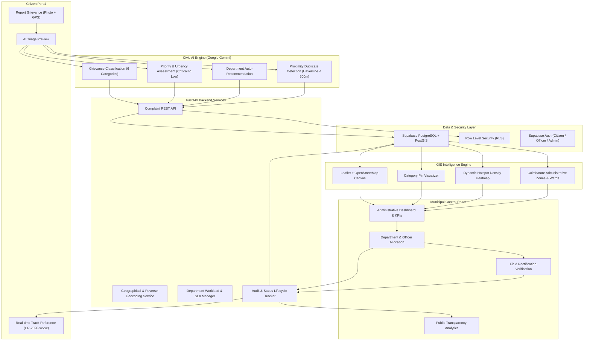
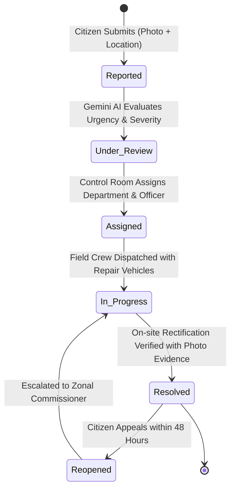

# CivicResolve Architecture & Technical Specification

## 1. System Overview

**CivicResolve** is an AI-powered municipal intelligence and citizen grievance management platform purpose-built for the Coimbatore Municipal Corporation in Tamil Nadu, India. It bridges citizens, municipal administrators, and zonal field officers through automated triage, real-time GIS visualization, and transparent resolution auditing.

---

## 2. Complaint Lifecycle State Machine

Every grievance progresses through an immutable 5-stage lifecycle:

---

## 3. Geographic Organization (Coimbatore Corporation)

Coimbatore is structured into 5 administrative zones and 100 wards:

1. **Central Zone (`CBE-CENTRAL`)**:
   - Localities: Gandhipuram (Ward 70), Race Course (Ward 72), Town Hall, Gopalapuram.
   - Key Nodes: Central Bus Stand, Cross Cut Road, Collectorate.
2. **West Zone (`CBE-WEST`)**:
   - Localities: R.S. Puram (Ward 23), Saibaba Colony, Vadavalli.
   - Key Nodes: DB Road, Cowley Brown Road, NSR Road.
3. **North Zone (`CBE-NORTH`)**:
   - Localities: Peelamedu (Ward 38), Saravanampatti, Ganapathy.
   - Key Nodes: Avinashi Road, PSG Tech Corridor, CHIL SEZ IT Park.
4. **East Zone (`CBE-EAST`)**:
   - Localities: Singanallur (Ward 55), Ramanathapuram, Ondipudur.
   - Key Nodes: Trichy Road, Singanallur Lake, Sungam Bypass.
5. **South Zone (`CBE-SOUTH`)**:
   - Localities: Ukkadam (Ward 84), Kuniyamuthur, Podanur.
   - Key Nodes: Periyakulam Bund, Ukkadam Flyover, Palakkad Highway.

---

## 4. Duplicate Grievance Prevention

Duplicate submissions are prevented via a dual-criteria proximity gate:
- **Haversine Distance**: Computes exact geographical distance in meters. Reports within 300m are flagged.
- **Token Jaccard Similarity**: Evaluates word overlap between grievance descriptions.
- If similarity is high, the citizen is offered the option to **endorse/support** the existing complaint, which automatically escalates the priority score without creating redundant database records.
